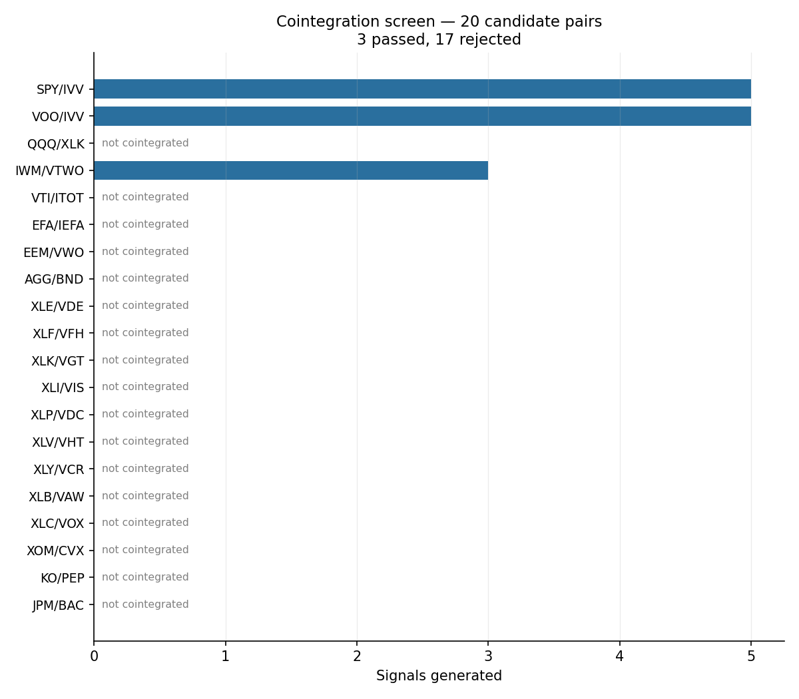
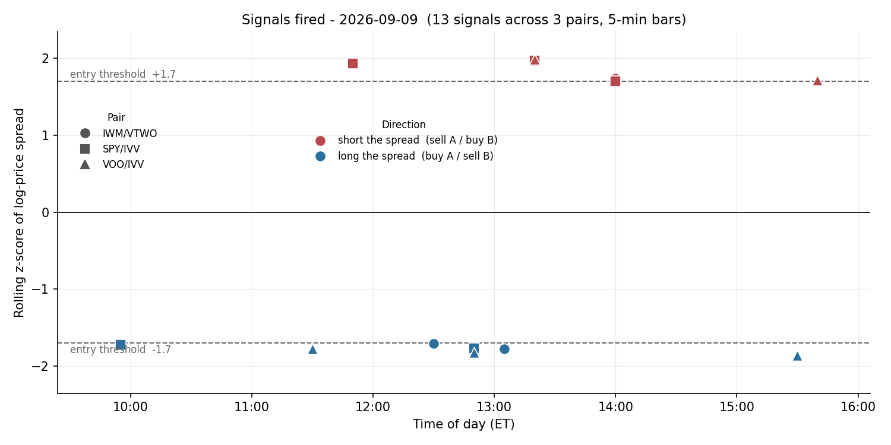
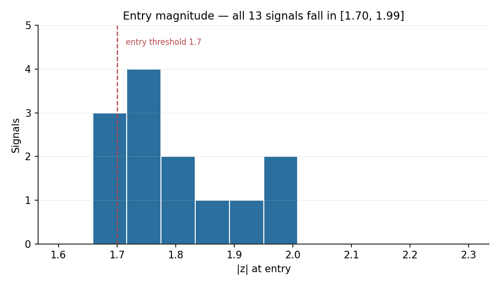

# Serendib Capital — Statistical Arbitrage Research

Cointegration-based pairs trading research on US equity ETFs, built in Python against
Interactive Brokers market data.

The repository contains a set of single-pair and multi-pair **signal models** built
around the Engle-Granger method: cointegration screening, hedge-ratio estimation, and
z-score entry signals on log-price spreads.

> **Status: research prototype.** This is a study of methodology, not a trading system
> with a track record. There is no live or paper record, and the signal-model path
> produces entry signals only — it has no position, cost or P&L model. Results below are
> reported as they came out, including the ones that failed.

---

## Contents

- [Method](#method)
- [Results](#results)
- [Repository layout](#repository-layout)
- [Installation](#installation)
- [Usage](#usage)
- [Model versions](#model-versions)
- [Known limitations](#known-limitations)
- [Roadmap](#roadmap)

---

## Method

The current implementation (`src/statarb_ver3_intraday.py`) uses the Engle-Granger
two-step procedure on log price levels.

**Step 1 — estimate the cointegrating vector.** Ordinary least squares on log prices:

```
log(A_t) = α + β · log(B_t) + ε_t
```

β is the cointegrating coefficient and α a level offset on log prices. Working in logs
makes β a dimensionless elasticity rather than a share ratio, so the resulting spread is
scale-invariant and comparable across pairs and across price levels.

**Step 2 — test the residual for stationarity.** `statsmodels.tsa.stattools.coint()`,
which applies MacKinnon critical values. This matters: a plain ADF test on a fitted OLS
residual uses the wrong null distribution and is biased toward declaring stationarity,
because the regression minimised that residual's variance in the first place.

**Tradable spread and signal.** With β and α from the formation window:

```
spread_t = log(A_t) − β · log(B_t) − α
z_t      = (spread_t − rolling_mean(spread)) / rolling_std(spread)
```

Entry at `|z| > threshold`: `z > +threshold` means A is rich relative to B (sell A, buy
B); `z < −threshold` means A is cheap (buy A, sell B).

**Formation / trading separation.** `scan_pairs()` fits β, α and the cointegration test
on a formation window that ends strictly before the trading window begins, then applies
those fixed parameters to the out-of-sample trading period. Pairs failing the
cointegration test are skipped rather than traded.

---

## Results

### Universe screen — 20 candidate pairs

A scan across 20 structurally-related ETF and equity pairs, fitted on one month of
5-minute bars and evaluated on the following session. **Three of twenty pairs passed the
cointegration test.**



The pairs that survived — SPY/IVV, VOO/IVV, IWM/VTWO — are all cases where the two
instruments track the *same* underlying index through different issuers. Every pair
relying on an economic rather than structural relationship (XOM/CVX, KO/PEP, JPM/BAC)
and every sector-ETF pair (XLK/VGT, XLF/VFH, XLE/VDE) was rejected at this sample size.

That result is worth stating plainly rather than tuning away: a screen that admits 15%
of hand-picked candidates is behaving as a screen should. The failures are the finding.

### Signals generated

13 signals across the three surviving pairs in one session.



### Entry magnitude



Every signal fired at `|z|` between **1.70 and 1.99** — none exceeded 2.0. With a
6-bar rolling window on 5-minute bars, the standard deviation in the z-score denominator
is estimated from 30 minutes of data, which is a noisy estimate that produces frequent
marginal breaches rather than rare extreme ones. The entry threshold and the window
length are doing more work here than the underlying spread dynamics, which is an
argument for replacing the rolling normalisation entirely (see [Roadmap](#roadmap)).

### Cointegration study — QQQ/SPY, January 2018 1-minute bars

An earlier, deliberately negative result on 8,190 bars:

| Test | Result | Conclusion |
|---|---|---|
| ADF on QQQ levels | p = 0.288 | I(1), non-stationary ✓ |
| ADF on SPY levels | p = 0.318 | I(1), non-stationary ✓ |
| OLS hedge ratio | β = 0.724, R² = 0.984 | tight linear fit |
| Log-return beta | β = 1.233, corr = 0.88 | |
| **Engle-Granger** | **p = 0.381** | **not cointegrated ✗** |
| **Johansen trace** | **12.59 < 15.49** | **fail to reject H₀** |
| ADF on spread | p = 0.177 | non-stationary |

R² of 0.984 alongside a cointegration p-value of 0.381 is the headline: **correlation is
not cointegration.** One month of data is also insufficient power for these tests — six
to twelve months is the usual minimum — so the honest reading is "not established," not
"disproved." Distinguishing low test power from genuine structural absence requires
re-running across multiple horizons before drawing any conclusion.

---

## Repository layout

```
src/
├── statarb_ver1.py            # price-level OLS hedge ratio + ADF
├── statarb_ver2.py            # log-return beta, log-price spread
├── statarb_ver3.py            # Engle-Granger on log levels + coint()
└── statarb_ver3_intraday.py   # ver3 + formation/trading split, multi-pair scanner

scripts/
└── make_figures.py            # regenerates docs/figures from a scan report
```

Each `statarb_ver*.py` is a self-contained script with its own data layer (Interactive
Brokers, falling back to Yahoo Finance, then to local files).

---

## Installation

```bash
git clone https://github.com/ShihanUTSA/serendib-capital.git
cd serendib-capital
python -m venv .venv && source .venv/bin/activate
pip install pandas numpy statsmodels matplotlib yfinance ib-insync
```

`nest_asyncio` is additionally required in notebook environments.

For Interactive Brokers data, TWS or IB Gateway must be running with API access enabled.
Connection parameters are read from `IB_HOST`, `IB_PORT` and `IB_CLIENT_ID`, defaulting
to `127.0.0.1:7496`. The client connects read-only and retries across several ports with
randomised client IDs to avoid stale-session collisions.

No market data is committed to this repository.

---

## Usage

**Single pair:**

```python
from statarb_ver3 import StatArbBot

bot = StatArbBot("LQD", "HYG", lookback_window=30, data_source="ib")
bot.fetch_data()
bot.calculate_beta_engle_granger()
if bot.check_cointegration():
    bot.generate_live_signals()
    bot.plot_performance()
```

**Multi-pair scan:**

```python
from statarb_ver3_intraday import scan_pairs

report = scan_pairs(
    [("SPY", "IVV"), ("VOO", "IVV"), ("IWM", "VTWO")],
    formation_period="1m", formation_interval="5m",
    trading_period="2d",  trading_interval="5m",
    lookback_window=6, z_threshold=1.7,
    data_source="ib", report_path="intraday_signal_report.csv",
)
```

`data_source` accepts `"ib"`, `"yfinance"`, or `"auto"` (Interactive Brokers, falling
back to Yahoo Finance, then to local files).

**Regenerate figures:**

```bash
python scripts/make_figures.py intraday_signal_report.csv
```

---

## Model versions

The three versions are kept deliberately, because the differences between them are the
substance of the research rather than superseded drafts.

| | Beta estimated on | Spread | Test | n |
|---|---|---|---|---|
| `ver1` | price levels | `A − β·B − c` | `adfuller` | T |
| `ver2` | log returns | `log A − β·log B` | `adfuller` | T−1 |
| `ver3` | log price levels | `log A − β·log B − α` | `coint` | T |

Three quantities, all called "beta," none interchangeable:

- **`ver1`** produces a *share* hedge ratio in the units of the two prices. A fixed share
  hedge lets dollar exposures drift apart as prices move, and the resulting dollar spread
  is heteroskedastic in the price level.
- **`ver2`** produces a *return sensitivity* — dimensionless. Applying it to price levels
  would be a unit error, which is why the spread moved to log prices when the regression
  changed.
- **`ver3`** produces the *cointegrating coefficient*, which is the coefficient whose
  residual the stationarity test actually validates. A return-regression beta is not
  guaranteed to equal it.

Engle-Granger is asymmetric: regressing `log(B)` on `log(A)` gives a different β. For
baskets of three or more assets, Johansen replaces it.

---

## Known limitations

Stated explicitly because they bound what the results above can mean.

- **No P&L anywhere.** These scripts emit entry signals only. Nothing here sizes a
  position, models a transaction cost, or scores an outcome. Every result below is a
  statement about signal generation, not about returns.
- **In-sample fitting in `ver1`–`ver3`.** β is fitted on the full sample and the z-score
  computed over those same bars. Only `statarb_ver3_intraday.py` separates formation from
  trading.
- **OLS residuals sum to zero by construction.** Any spread built this way is mean-zero
  in its fitting window whether or not the pair is cointegrated — the same algebra that
  makes ADF-on-fitted-residual unreliable.
- **Rolling-window normalisation is a free parameter.** `lookback_window` has no
  principled value and directly controls signal frequency.
- **No multiple-testing adjustment.** Screening 20 pairs and reporting the survivors
  invites selection bias; nothing here corrects for it yet.
- **Capacity.** SPY/IVV and VOO/IVV are among the most efficiently arbitraged
  relationships in US equities, policed continuously at the creation/redemption level.
  A statistically valid spread there is not evidence of an economically accessible one
  after costs.

---

## Roadmap

1. **Kalman-filtered time-varying hedge ratio.** Model `[β_t, α_t]` as a random walk
   observed through `log A_t = β_t · log B_t + α_t + v_t`, with the noise covariances
   fitted by maximum likelihood rather than hand-tuned. The standardised innovation
   `e_t/√S_t` is a z-score normalised by the filter's own predicted variance — removing
   the rolling-window parameter entirely, and free of look-ahead by construction.
2. **Ornstein-Uhlenbeck fit on the filtered spread** for reversion speed and half-life,
   giving a model-implied holding period and threshold instead of a chosen one.
3. **Spectral diagnostics.** Welch power spectrum of each spread; the dominant frequency
   gives an empirical reversion timescale to cross-check against the OU half-life.
   Disagreement between the two is itself informative.
4. **Representation ablation** across `ver1` → `ver2` → `ver3` → Kalman on identical
   data, splits and cost assumptions.
5. **Validation discipline.** Purged and embargoed walk-forward splits, a trial counter
   covering every parameter variant, and Deflated Sharpe reporting.
6. **Event-driven backtester** with a realistic cost model — bid-ask spread, commissions
   and slippage — and a single code path shared with a live paper-trading runner.
7. **Johansen** for baskets beyond two assets.

---

## License

MIT

## Author

**Shihan (Thilina Weerathunga)** — [github.com/ShihanUTSA](https://github.com/ShihanUTSA)
